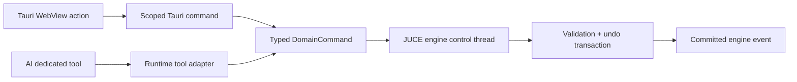
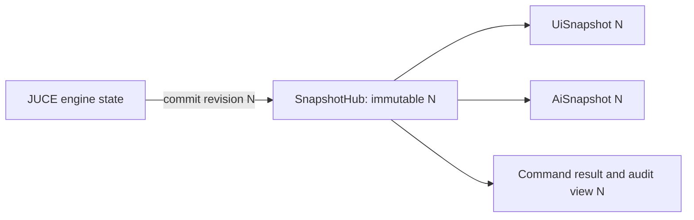

# JUCE + Tauri Rewrite Blueprint

Status: proposed migration source of truth  
Scope: preserve Reidom's AI and arranging experience while replacing the
Ardour/GTK product host with a Reidom-owned JUCE engine and Tauri application  
Commercial intent: closed-source distribution is allowed only after the JUCE
licence and every bundled asset or dependency have passed release review

## 1. Product decision

Reidom should not become a visual copy of Ardour. The target is a lightweight,
MIDI-first arranging product with an integrated copilot:

- JUCE owns audio, MIDI, transport, plugin hosting, project state, editing, and
  the real undo history.
- Tauri owns the application lifecycle, WebView, account/provider settings,
  AI Runtime integration, process supervision, updates, and product UI.
- The WebView renders one revisioned snapshot. It does not own a second project
  model.
- Human edits and AI edits enter the same typed command service.
- The AI keeps narrow musical tools. A generic hidden mutation endpoint is not
  exposed to the model.
- The interface is canvas-first and progressively reveals advanced panels. It
  does not keep an Ardour-sized mixer, inspector, history, provider editor, and
  assistant visible at the same time.

This is a product rewrite, not a code port. Ardour-specific GTK, session,
`mcp_http`, and control-surface code should not be carried into the new app.

## 2. Two non-negotiable contracts

### 2.1 One bottom-level tool call path

Every mutation must resolve to the same JUCE engine command processor:



The public surfaces may differ, but the bottom call cannot differ:

- WebView: a small allowlisted Tauri command or channel message.
- AI Runtime: a dedicated Agent Tool registered through the Runtime SDK.
- MIDI controller or future automation: the same internal `DomainCommand`.
- Importer or DAW adapter: the same internal `DomainCommand` with a different
  `source`.

The Runtime tool adapter and Tauri commands are translators, not state owners.
They must never implement musical edits independently.

### 2.2 One snapshot source for UI and AI

The JUCE engine is the project source of truth. A Tauri `SnapshotHub` may cache
the latest immutable snapshot, but it cannot invent or mutate project state.



`UiSnapshot` and `AiSnapshot` are two projections of the same committed
`ProjectSnapshot` revision. The AI must never receive a separately polled or
independently reconstructed project view.

Rules:

1. Load a full snapshot when a project opens.
2. Apply engine deltas only when `from_revision` matches the current revision.
3. Request a full resync on a gap, checksum mismatch, or engine restart.
4. Include `source_revision` in every AI snapshot and command request.
5. Keep hover, scroll, open panels, text drafts, and temporary drag geometry as
   view-local state; never mix them into project state.
6. Keep optimistic edits as a temporary overlay keyed by `command_id`. Replace
   them with the committed snapshot or remove them after rejection.
7. Reconcile optimistic user messages by `client_message_id`; do not match
   against broad transcript text.

## 3. Target process architecture

The recommended default is process isolation:

```text
reidom-app (Tauri/Rust)
  - product window and WebView IPC
  - SnapshotHub and event fan-out
  - ai-framework Runtime host
  - tool permissions, providers, conversations, recovery
  - engine/tool/plugin-scanner supervision
        |
        | versioned local IPC, authenticated per launch
        v
reidom-engine (JUCE/C++)
  - project/session and revision owner
  - audio/MIDI device graph and transport
  - tracks, clips, notes, automation, routing
  - plugin hosting and parameter state
  - command validation and transaction/undo engine
  - snapshot and committed-event producer

reidom-tools (Rust or Python during migration)
  - ai-framework Agent Tool gRPC endpoint
  - narrow tool schemas and concise to_ai output
  - translates tools to the same engine query/command IPC
```

Why separate the JUCE engine:

- an audio or plugin failure does not have to destroy the WebView and
  conversation;
- the Tauri UI can restart and reattach to a running project;
- plugin scanning can be isolated further;
- model/network/RPC work stays away from the real-time audio callback;
- engine protocol tests do not require a GUI.

The engine's audio callback must not allocate, block, perform IPC, acquire
unbounded locks, access files, or call the AI Runtime. UI/AI commands enter a
control-thread queue. Real-time parameter and MIDI changes cross to the audio
thread through bounded lock-free queues or atomics.

## 4. Versioned engine protocol

Use generated types between Rust and C++. Protobuf over a local named pipe or
loopback transport is a practical first choice because the current Runtime tool
path already uses gRPC. The transport can change later; the message contract
must not.

### 4.1 Command envelope

```json
{
  "schema": "reidom-command/v2",
  "command_id": "cmd_01...",
  "idempotency_key": "01...",
  "project_id": "project_01...",
  "base_revision": 42,
  "source": "user | ai | controller | importer",
  "type": "notes.move",
  "selection_ref": "selection_01...",
  "payload": {},
  "reason": "Move the pickup slightly later.",
  "preview": false
}
```

Required behavior:

- reject stale `base_revision` values with the current revision;
- make `idempotency_key` safe to retry after IPC timeouts;
- validate IDs, ranges, roles, plugin parameters, and project ownership;
- never accept raw script, SQL, shell, arbitrary method, or untyped JSON patch
  as an AI mutation;
- group all operations in a command into one named undo transaction;
- return the affected IDs and a bounded structural diff;
- emit a committed event only after the engine state and undo record agree;
- support `preview=true` without mutating the project.

### 4.2 Command result

```json
{
  "schema": "reidom-command-result/v2",
  "command_id": "cmd_01...",
  "accepted": true,
  "before_revision": 42,
  "revision": 43,
  "affected_ids": ["note_17", "note_18"],
  "summary": "Moved 2 notes by 0.125 beats.",
  "diff": {},
  "undo_group_id": "undo_01..."
}
```

Failures must use stable codes such as `stale_revision`, `unknown_target`,
`invalid_range`, `permission_denied`, `plugin_unavailable`, `engine_busy`, and
`unsupported_operation`. User-facing text stays short; diagnostics retain the
command ID internally.

### 4.3 Multi-operation transactions

The existing Ardour tools execute multi-track work as separate verified steps.
The JUCE engine should add a bounded transaction without exposing arbitrary
scripts:

```json
{
  "type": "edit.transaction",
  "payload": {
    "operations": [
      { "type": "region.notes.replace", "payload": {} },
      { "type": "track.instrument.set", "payload": {} }
    ]
  }
}
```

Limits:

- one project and one `base_revision`;
- allowlisted operation types only;
- validate the complete transaction before applying any operation;
- one commit, one revision increment, and one undo group;
- hard limits on operation count, affected notes, regions, and serialized size;
- rollback all changes if any operation or post-commit verification fails.

## 5. Snapshot contract

### 5.1 Canonical project snapshot

`ProjectSnapshot` should contain only committed product state:

- project identity, revision, dirty/save state;
- tempo and time-signature maps;
- transport and loop state;
- tracks, roles, routing, mute/solo/arm, instrument references;
- clips/regions, sections, markers, and automation summaries;
- MIDI notes for the active bounded viewport/selection;
- plugin descriptors and parameter summaries, not opaque plugin memory;
- explicit selection with track, clip, note, section, and time-range IDs;
- undo/redo availability and recent command summaries;
- engine health and device status.

Do not serialize raw audio buffers, entire plugin state blobs, complete long
projects, file-system paths unnecessary to the current decision, or frontend
layout into every snapshot.

### 5.2 UI projection

The UI projection contains display-ready state for the current workspace:

- arrangement viewport and visible clips;
- selected clip piano-roll notes;
- compact track and device summaries;
- current transport and meters at a separately throttled rate;
- command status and non-technical error text.

Meter frames are ephemeral telemetry and do not advance the project revision.
They use their own sequence number and may be dropped under load.

### 5.3 AI projection

The AI projection is bounded and musical:

- source project and revision;
- explicit selection and protected material;
- tempo, meter, key estimate, section, and track roles;
- note count, span, range, density, phrase blocks, chord estimate, and melody
  anchors;
- available dedicated tools and relevant limits;
- recent AI/user command summaries needed for continuation.

It omits pointer state, raw tool-call IDs, full plugin catalogs, full command
payload history, renderer internals, and private credentials.

## 6. AI assets to preserve

### 6.1 Runtime and conversation experience

Preserve these completed ideas independent of Ardour:

- Runtime load/register/start/spawn/next-event lifecycle;
- provider and model management;
- conversation creation, switching, snapshot export, and recovery;
- permission prompts for mutating tools;
- dynamic snapshots attached before user requests;
- optimistic user message rendering with ID-based reconciliation;
- pseudo-streamed assistant rendering when the provider response is not truly
  streamed;
- compact tool-call bubbles that hide raw call IDs;
- short plain-language tool summaries;
- stop/cancel, retry, history, and connection diagnostics.

Do not port the GTK widget implementation. Port its behavior and tests into the
Tauri conversation state model.

### 6.2 Read and edit tools

Preserve the intent of the current tool inventory, but rename it away from
`Ardour*`:

- session, transport, track, region, note, plugin, and history reads;
- track/region/note creation and bounded note edits;
- selection, quantize, transpose, velocity, duplicate, move, and resize;
- instrument preset assignment;
- effects, plugin enable/parameter, sends, and routing;
- undo and redo;
- deterministic MIDI analysis;
- harmony planning and generation;
- chord-timeline writing;
- humanize, drum, bass, and accompaniment generation.

Each future tool keeps a narrow schema. For example,
`ReidomWriteChordTimeline` may translate to one `region.notes.replace` domain
command, while `ReidomSetInstrumentPreset` translates to one
`track.instrument.set` command. Tool names do not become engine method names.

### 6.3 Musical intelligence

Preserve the deterministic, inspectable musical layer:

- note normalization and bounded structural analysis;
- key and chord estimation treated as estimates;
- phrase-wide harmony search instead of isolated chord guesses;
- melody-fit, cadence, style-fit, repetition, and voice-leading scoring;
- inversions and common-tone voice leading;
- chord symbols including seventh, ninth, suspended, diminished, altered, and
  slash-bass forms supported by the current parser;
- explicit chord timeline syntax, for example:

```text
4/4 @1:1-5:1 | Am7(3) C7/E(1) Fmaj7(3) D7/F#(1) G7(3) G7/B(1) Cadd9(4) || arp(up, rate=1/8, oct=2, gate=0.85)
```

- separate harmonic duration from performance subdivision;
- block, up, down, up/down, Alberti, and seeded-random patterns;
- deterministic humanize;
- role-aware drum, bass, and accompaniment foundations;
- hard event/range limits and post-write structural rereads.

Do not claim rendered-audio listening, loudness-matched A/B selection, or
quality judgments until the new engine has an explicit offline render/analyse
pipeline and objective metrics. Even then, subjective taste remains with the
user.

### 6.4 Instrument preset behavior

Keep logical product presets such as `piano`, `electric_piano`,
`electric_guitar`, `acoustic_guitar`, `electric_bass`, `drums`, `strings`,
`organ`, and `synth`.

Change the implementation:

- map a logical preset to an owned or separately licensed sound source;
- keep the mapping in a versioned product catalog;
- let the user override a logical preset with an installed plugin;
- never ask the model to choose an arbitrary plugin when the user says
  "piano" or "electric guitar";
- do not make the current x42 General MIDI bundle a default closed-product
  dependency until redistribution and GPL boundaries have a formal review.

## 7. Skill experience to preserve

Keep the current role/feature separation, with all core instructions inline in
each `SKILL.md`. Do not add a runtime subresource or progressive Skill loader.

### 7.1 Role Skill

The arranger role should remain host-independent and enforce:

- evidence order: user intent, current snapshot, deterministic analysis,
  conservative defaults;
- a minimal brief: target section, goal, style, tempo/meter, harmonic basis,
  protected material, and voice roles;
- professional evaluation across section function, harmony, rhythmic hierarchy,
  voice roles, register, texture, and density;
- melody harmonization across the complete phrase;
- style-aware harmony without adding complexity for its own sake;
- transition chords only when melody fit and bass motion justify them;
- part-writing rules for drums, bass, harmony, leads, counterlines, and
  humanization;
- one focused reversible step followed by reread and one targeted repair;
- a maximum of two repair passes before asking for taste direction;
- short musical explanations without internal technical noise.

### 7.2 Native DAW feature Skill

Replace the Ardour-specific feature with a Reidom-native feature after the
tools exist. It should require this workflow:

1. Read the current `source_revision`, project, transport, tracks, and explicit
   selection.
2. Analyze every region that controls the next musical decision.
3. Plan harmony before generating melody-derived piano.
4. Create or confirm empty target regions before generative writes.
5. Use dedicated tools and a concise musical `reason`.
6. Apply one bounded command or explicit transaction.
7. Wait for the committed revision and reread the affected projection.
8. Compare structural before/after facts and stop cycling after two repairs.
9. Use undo/redo only on user request, rejection, or explicit recovery.

Never claim unsupported audio audition, arbitrary plugin choice, hidden file
editing, cross-project transactions, or compatibility with an unimplemented
DAW bridge.

## 8. Lightweight UI direction

The current visual direction is too heavy because it presents too many DAW and
AI management surfaces at once. The new product should have three primary
layers:

```text
48px transport / project bar
-----------------------------------------------
workspace canvas                 copilot drawer
arrangement OR piano roll        collapsed by default
-----------------------------------------------
context drawer: mixer / device / history, one at a time
```

### 8.1 Product rules

- Make arrangement and piano roll the visual center.
- Show one editing mode at a time; use a direct toggle or double-click into a
  clip rather than stacking both full editors.
- Keep the copilot as a 360-420 px resizable drawer that can collapse to one
  icon and unread badge.
- Open mixer, device chain, automation, command history, provider setup, and
  diagnostics as contextual drawers or focused routes, not permanent chrome.
- Keep a single slim transport bar with play, position, tempo, meter, loop,
  undo, save status, and command palette.
- Use one neutral surface family, one accent color, sparse borders, almost no
  elevation, and compact typography.
- Prefer whitespace and alignment over boxed cards.
- Hide raw tool-call IDs, provider IDs, region IDs, endpoints, and stack traces.
  Keep them accessible only in a developer inspector or copied diagnostic.
- Render tool calls as small status bubbles: action name, current state, and a
  short result. Expand only on demand.
- Keep user message bubbles compact, low-contrast, and width-bounded. Do not
  imitate a consumer messenger inside a professional workspace.
- Reserve animation for panel transitions, optimistic/committed reconciliation,
  playhead movement, and progress. Avoid ambient motion.

### 8.2 Frontend implementation

Use Lit for the application shell and conversation components to retain the
current conversation behavior with less framework overhead. Use Canvas2D for
the first arrangement and piano-roll implementation; move only the proven hot
paths to WebGL if profiling requires it.

Recommended frontend stores:

- `snapshotStore`: read-only committed `UiSnapshot`;
- `optimisticStore`: temporary command and message overlays;
- `viewStore`: viewport, zoom, open drawers, hover, and text drafts;
- `conversationStore`: Runtime ledger projection and tool/permission states.

No component may keep its own durable copy of tracks, clips, notes, selection,
or undo history.

## 9. What to reuse, rewrite, and retire

| Area | Decision | Reason |
| --- | --- | --- |
| ai-framework Runtime and SDK contracts | Reuse | Apache-2.0 in the checked upstream tree; preserves conversation/tool lifecycle |
| Conversation behavior and tests | Reimplement in Tauri/Lit | Keep UX semantics without GTK coupling |
| Musical planners and chord DSL | Port and then share as a library/service | Deterministic, testable product knowledge |
| Role and feature Skill rules | Reuse and rename incrementally | Valuable host-independent workflow guardrails |
| MIDI selection and command schemas | Evolve to v2 | Good boundary; needs engine revision/event/transaction semantics |
| Python tool implementations | Use as migration oracle | Replace hot/product paths with Rust/C++ after parity tests |
| Ardour C++/GTK integration | Retire | GPL host coupling and heavy UI are no longer the product direction |
| `mcp_http` bridge | Retire | Avoid duplicate transport and session-scoped lifecycle |
| Tauri prototype UI | Use only as behavior reference | Current state ownership and visual density are not the target |
| x42 GM default bundle | Replace or optionalize | Closed-product redistribution needs a separate legal/product decision |

Do not copy GPL Ardour implementation into a proprietary JUCE product. Write
the new engine from Reidom's contracts, tests, and documented behavior.

## 10. Commercial boundary

This section is engineering guidance, not legal advice.

- Tauri code is generally available under MIT or Apache-2.0. Keep its licence
  notices and audit every Rust/npm dependency separately.
- The checked `ai-framework` and `ai-conversation-ui` trees use Apache-2.0 and
  include a NOTICE file. Preserve the licence, modification notices, and NOTICE
  obligations when redistributing derivatives.
- JUCE 8 is dual-licensed. An externally distributed closed-source product
  should budget and maintain the appropriate JUCE commercial licence; the
  alternative AGPL route is not a closed-source commercial path.
- CLAP is MIT-licensed and is a strong first plugin format.
- VST 3 SDK 3.8 and later is MIT-licensed, but using the VST name/logo brings
  trademark guidelines. Preserve the relevant notices and review product
  wording.
- Do not carry Ardour GPL code, GTK integration code, or its modified binary
  into the proprietary product package.
- Audit plugins, sample libraries, impulses, presets, fonts, icons, model
  weights, and telemetry/crash SDKs independently. A permissive host does not
  make bundled content permissive.
- Generate an SBOM and third-party notices for every release artifact.

Official references:

- JUCE licensing: <https://juce.com/get-juce/>
- JUCE 8 EULA: <https://juce.com/legal/juce-8-licence/>
- Tauri repository licences: <https://github.com/tauri-apps/tauri>
- CLAP repository and licence: <https://github.com/free-audio/clap>
- VST 3 licensing: <https://steinbergmedia.github.io/vst3_dev_portal/pages/VST%2B3%2BLicensing/Index.html>

## 11. Migration sequence

### Phase 0: freeze contracts

- Name the v2 command, result, event, project snapshot, UI snapshot, and AI
  snapshot schemas.
- Convert current Python/Ardour tests into black-box behavior fixtures.
- Capture the current tool inventory, concise `to_ai` results, chord planner
  outputs, and conversation reconciliation cases.
- Add a licence inventory before new dependencies enter the product.

Exit: the same fixture can be consumed by Python, Rust, and C++ tests.

### Phase 1: JUCE engine skeleton

- Start a JUCE engine process without a WebView.
- Implement project open/new, transport, MIDI track/clip/note state, revision,
  command validation, snapshots, and undo/redo.
- Prove audio-thread isolation and engine restart/reconnect.
- Implement one read and one mutation end to end.

Exit: `notes.move` returns a revisioned result, emits an event, updates one
snapshot, and undoes in a headless test.

### Phase 2: light Tauri shell

- Build the minimal transport, arrangement canvas, clip selection, and piano
  roll.
- Subscribe once to `SnapshotHub`; forbid direct engine reads from components.
- Add optimistic overlays and revision reconciliation.
- Keep mixer, device, history, and copilot drawers collapsed by default.

Exit: the user can create/open a project, edit notes, undo, save, and reopen it
without AI.

### Phase 3: AI Runtime and tool parity

- Host the Runtime in Tauri/Rust.
- Register the same role Skill and the new Reidom-native feature Skill.
- Route dedicated tools through the engine command contract.
- Feed AI and UI projections from the same snapshot revision.
- Port permissions, providers, conversation recovery, tool bubbles, optimistic
  messages, and pseudo-streaming.

Exit: a user edit and an AI edit produce the same command/result/event/undo
shape and appear against the same snapshot revision.

### Phase 4: musical parity

- Port analysis, harmony planner, chord timeline, deterministic humanize,
  drums, bass, accompaniment, and instrument presets.
- Add multi-region transaction support.
- Verify generated ranges, spans, density, melody fit, voice leading, and undo.

Exit: the existing representative MIDI fixtures produce equivalent or better
structural results through the new engine.

### Phase 5: plugin and commercial release

- Add CLAP first, VST 3 second, and isolate scanning/crash-prone plugins.
- Finalize owned/licensed default sounds.
- Add signed updates, crash recovery, privacy controls, secret storage, and
  opt-in telemetry.
- Produce SBOM, notices, installer tests, and JUCE licence evidence.

Exit: a clean machine can install, create music, recover after an engine crash,
and uninstall without hidden prerequisites.

## 12. Acceptance tests

The rewrite is not closed until all of these pass:

1. UI and AI report the same `source_revision` for the same selection.
2. A user note edit and an AI note edit reach the same engine command handler.
3. A duplicated IPC request with the same idempotency key changes state once.
4. A stale command is rejected without partial mutation.
5. A multi-track transaction commits fully or rolls back fully.
6. Undo/redo restores the same snapshot checksum.
7. WebView reload does not lose or fork project state.
8. Engine restart produces a full resync without duplicating optimistic edits.
9. Audio continues without blocking while AI streams, tools run, or snapshots
   are serialized.
10. Raw tool-call IDs and diagnostics are hidden from normal product UI.
11. Conversation replay does not render an optimistic user message twice.
12. The default layout opens with only transport, one editor, and a collapsed
    copilot; advanced surfaces appear on demand.
13. Chord timelines preserve durations, slash bass, voicing, arpeggio pattern,
    event limits, and one-step undo.
14. Release packaging contains the expected licences, NOTICE, SBOM, and no
    Ardour GPL binary or unapproved sound library.

## 13. First implementation slice

Do not begin with plugin hosting or a full mixer. Build this closed loop first:

```text
Tauri arrangement click
  -> notes.move command at base revision N
  -> JUCE engine validates and commits revision N+1
  -> one ProjectSnapshot N+1 enters SnapshotHub
  -> UI renders UiSnapshot N+1
  -> AI receives AiSnapshot N+1
  -> undo restores revision N+2 with the previous musical state
```

Once this loop is stable, the existing AI and arranging capabilities can move
over without recreating the Ardour integration problems inside a new shell.
